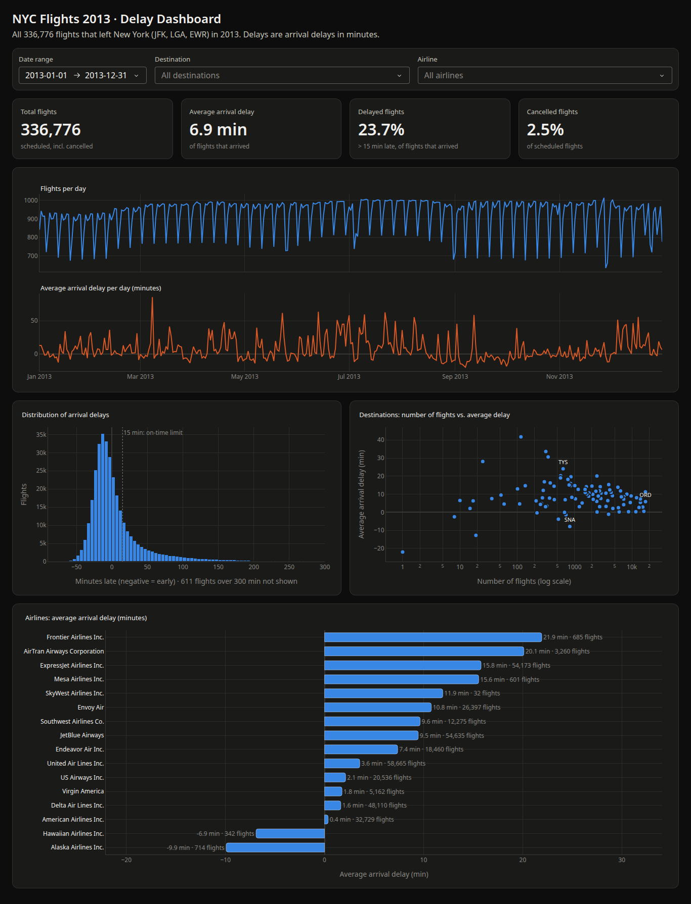

# Flight Data Analysis Dashboard

An interactive dashboard, built with **Dash** (Python), for exploring flight delays.
It uses the **nycflights13** dataset: all 336,776 flights that left New York City's
three airports (JFK, LaGuardia and Newark) during 2013.

Midterm project, Allameh Helli 7 high school, Tehran.

📄 A Persian technical document explaining how the project was built: [docs/technical-doc-fa.pdf](docs/technical-doc-fa.pdf)



## What the dashboard shows

- **Filters:** date range, destination(s) and airline(s). Every card and chart updates when you change them.
- **KPI cards:** total flights, average arrival delay, % of flights delayed (more than 15 min late) and % cancelled.
- **Chart 1:** flights per day and average delay per day over time.
- **Chart 2:** histogram of arrival delays.
- **Chart 3:** scatter plot of destinations, comparing number of flights with average delay.
- **Chart 4:** airline comparison: average delay and number of flights.

## Installation

You need Python 3.11 or newer (pandas 3 requires it). This project was built with Python 3.14.

```bash
# 1. Create a virtual environment (an isolated place for this project's libraries)
python3 -m venv .venv

# 2. Activate it
source .venv/bin/activate        # Linux / macOS
# .venv\Scripts\activate         # Windows

# 3. Install the libraries
pip install -r requirements.txt
```

The cleaned data (`data/clean_flights.parquet`, 11 MB) is included in the repo, so the dashboard runs right after installing.

The raw `data/flights.csv` (43 MB) is **not** in git, because it is too large. You only need it to rebuild the cleaned file (`data_prep.py`) or to run the checks (`check_numbers.py`). Put it at `data/flights.csv`.

## How to run

```bash
# Start the dashboard (uses the included data/clean_flights.parquet)
python src/app.py

# Optional: print the analysis report in the terminal
python src/analysis.py

# Optional, needs data/flights.csv: rebuild the cleaned data from the raw CSV
python src/data_prep.py
```

Then open **http://127.0.0.1:8050** in your browser. Press `Ctrl+C` in the terminal to stop the app.

## Online version

The dashboard can run online for free on [Render](https://render.com):

1. Sign in to render.com with your GitHub account.
2. Click **New → Blueprint**, choose this repository, and click **Apply**. Render reads `render.yaml` and builds the app from the `Dockerfile`. This takes a few minutes.
3. Open the `https://….onrender.com` address that Render shows.

On the free plan the app goes to sleep after 15 minutes without visitors. The first visit after that takes about a minute while it wakes up. Every `git push` redeploys the app automatically.

The free plan has 512 MB of memory, so `app.py` only loads the 7 columns it needs. That brings peak memory down from about 450 MB to under 300 MB.

## Project files

| File | What it does |
|---|---|
| `data/flights.csv` | The original data. It is never changed. |
| `data/clean_flights.parquet` | The cleaned data made by `data_prep.py` (included in the repo). Parquet is a compressed format: 11 MB instead of 43 MB, and it loads in about 0.06 s. |
| `src/data_prep.py` | Cleans the data: flags cancelled/diverted flights, handles missing values, builds real date/time columns, and adds day of week and delay category. Prints a report of what changed. |
| `src/analysis.py` | Small functions that each answer one question (flights per month, delay distribution, airline comparison, top destinations). Prints the key findings. The dashboard reuses these functions. |
| `src/app.py` | The Dash dashboard: the page layout, the filters, and one callback that filters the data and redraws everything. |
| `src/check_numbers.py` | Checks that the dashboard's KPI numbers match numbers calculated directly from the raw CSV. Prints PASS/FAIL. |
| `src/assets/style.css` | The dark theme. Dash loads every CSS file in `assets/` automatically. |
| `docs/` | The dashboard screenshot and the Persian technical document (PDF, its HTML source, and the Vazirmatn font). |
| `requirements.txt` | The list of libraries (with exact versions) the project needs. |
| `Dockerfile` | Recipe for running the app online: installs Python and the libraries, then starts the app with gunicorn (a production web server). |
| `render.yaml` | Tells render.com how to host the app (free plan, built from the Dockerfile). |

## Decisions about the data

- **No rows were deleted.**
  - 8,255 flights (2.5%) were **cancelled** and 1,175 (0.3%) were **diverted**. They are kept and marked with `cancelled` / `diverted` columns.
  - They count in "total flights", but not in delay averages, because they have no arrival delay.
- **Delay means arrival delay** (`arr_delay`, in minutes; negative = arrived early). That is what passengers feel.
- **Delay categories:** On time ≤ 15 min (the official US definition), Small 16–45, Medium 46–120, Large > 120.
- **Missing delay values were not filled with 0.** That would pretend cancelled flights were on time.

## Findings

1. **Summer and December are the worst times to fly.**
   - July is the busiest month (29,425 flights) and also the most delayed: on average 16.7 min late, with 31.5% of flights delayed.
   - June and December are almost as bad.
   - September is the best month: flights arrived 4 min *early* on average.
2. **The "average delay" hides the real picture.**
   - The typical (median) flight arrives **5 minutes early**, and 59% arrive early or exactly on time.
   - The average is still 6.9 min *late*, because a small number of very long delays (up to 21 hours) pull it up. The distribution is skewed.
3. **Airlines are very different.**
   - Among the larger airlines, American (0.4 min) and Delta (1.6 min) have the lowest average delays.
   - AirTran (20.1 min) and ExpressJet (15.8 min) have the highest. ExpressJet also cancelled 5.2% of its flights.
4. **There is a weekly rhythm.**
   - Saturdays have about 23% fewer flights than an average weekday.
   - Saturday is also the only day when flights arrive early on average (−1.4 min).
   - Thursday is the worst day (+11.7 min).
5. **One bad day can be extreme.** On 8 February 2013, the day of a big snowstorm (the media called it "Nemo"), **50.8% of flights were cancelled**, compared with 2.5% over the whole year. To see it, set the date range to just that day and look at the "Cancelled flights" card. The "flights per day" chart does *not* show a dip, because it counts scheduled flights, including cancelled ones.

## How the numbers were checked

You can rerun the main check yourself:

```bash
python src/check_numbers.py
```

- It takes 4 filter cases: the whole year, July with United only, ATL/ORD on Delta/American, and 8 February only.
- For each case it calculates total flights, average arrival delay, % delayed and % cancelled in two separate ways: with the dashboard's own functions, and with plain pandas on the raw CSV.
- It prints PASS or FAIL for each number and ends with "All checks passed." if everything agrees.

During development, a longer version of this check was also run:

- For 11 filter combinations, the dashboard's numbers were compared with numbers recomputed directly from the raw CSV with pandas. The combinations included a single day, several destinations with several airlines, a destination with only one (cancelled) flight, and filters that match nothing. All of them matched.
- The chart data also adds up: daily flight counts, histogram bins and airline averages all agree with the raw data.
